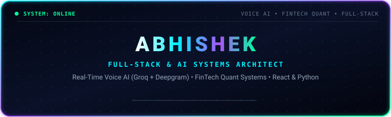
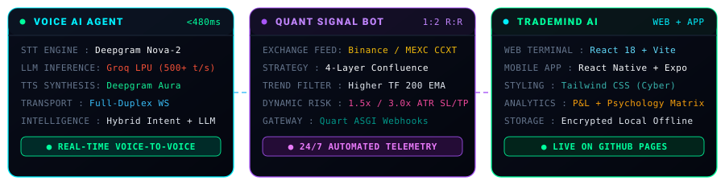
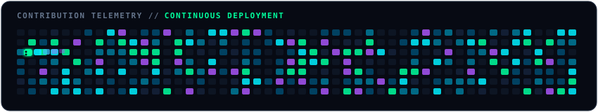

 

  
  
  
  
  
  

## 👨‍💻 Executive Engineering Profile

I am a **Full-Stack Developer and AI Systems Architect** specializing in production-grade conversational AI voice agents, business workflow automations, full-stack multi-platform SaaS applications, and quantitative financial algorithmic engines.

* 🎙️ **Conversational AI & Audio**: Built **[Nexus Voice AI](https://uniqabhishek.github.io/AI-Voice-Assistant/)**, an advanced voice agent engineered to **ChatGPT-4o & Gemini Live** standards featuring **Simultaneous Bilingual Auto-Detection (Hindi + English)**, full-duplex speech barge-in interruption (*say "रुको" / "stop"*), dynamic liquid neural orb visualizer, continuous hands-free listening, direct YouTube autoplay & voice stream controls, and multi-tier reasoning.
* 🏋️‍♂️ **Business Workflow Automation & WhatsApp Ops**: Engineered **[GymFlow Pro](https://uniqabhishek.github.io/gymflow-automation/)**, a smart gym automation and member renewal platform with automated WhatsApp reminders, dynamic UPI payment QR codes, packaged Android native APK, and an importable n8n workflow pipeline.
* 🍽️ **Restaurant Operations SaaS & Real-Time Ops**: Engineered **[RestoFlow ONE](https://uniqabhishek.github.io/smart-restaurant-qr/)**, a contactless smart QR restaurant dine-in ecosystem featuring real-time kitchen display ticketing (KDS Kanban), dynamic staff table radar floor maps, and downloadable Android Demo APK.
* ⚡ **FinTech & Behavioral Analytics**: Architected **[TradeMind AI](https://uniqabhishek.github.io/Trading-Journal/)**, an institutional-grade trading journal and psychological discipline workspace deployed across React 18, React Native (Expo), and Python Flask.
* 🤖 **Quantitative Algorithmic Systems**: Engineered **[QuantSignal AI](https://github.com/uniqabhishek/Trading-Bot)**, an asynchronous market scanner operating a 4-layer quantitative strategy with CCXT multi-exchange failover, Quart ASGI webhooks, and ATR dynamic risk sizing (1:2 R:R).
* 🎯 **Status**: **Open for High-Impact Software Engineering Roles** — actively interviewing for Full-Stack Developer, AI Software Engineer, and Python Developer positions.

  

## 📐 Real-Time System Architecture

  

  

## 📊 Live Deployments & Executive Dashboard

| Project | Domain | Architecture & Highlights | Live Web App | Mobile / APK | Source Code |
| :--- | :--- | :--- | :--- | :--- | :--- |
| **Nexus Voice AI** | Conversational AI & Web Audio | Full-Duplex Barge-In, Dual Hindi + English Auto-Detect, Groq LPU, YouTube Stream | [🚀 Launch Terminal](https://uniqabhishek.github.io/AI-Voice-Assistant/) | *Browser PWA* | [📂 Repository](https://github.com/uniqabhishek/AI-Voice-Assistant) |
| **GymFlow Pro** | Automation & WhatsApp SaaS | n8n Pipeline, WhatsApp Cloud API, Dynamic UPI QR, Member Expiry Tracker | [🚀 Launch App](https://uniqabhishek.github.io/gymflow-automation/) | [📲 Android APK](https://github.com/uniqabhishek/gymflow-automation/blob/main/GymFlow-Demo-v1.0.apk) | [📂 Repository](https://github.com/uniqabhishek/gymflow-automation) |
| **RestoFlow ONE** | Hospitality SaaS & Real-Time Ops | React 19, Smart QR Ordering, Kitchen KDS Kanban, Staff Floor Map Radar | [🚀 Launch Terminal](https://uniqabhishek.github.io/smart-restaurant-qr/) | [📲 Demo APK](https://github.com/uniqabhishek/smart-restaurant-qr/releases/download/v1.0.0-demo/RestoFlow-Demo.apk) | [📂 Repository](https://github.com/uniqabhishek/smart-restaurant-qr) |
| **TradeMind AI** | FinTech & Quantitative Journal | React 18, React Native (Expo), Tailwind, Encrypted Offline Storage | [🚀 Launch Terminal](https://uniqabhishek.github.io/Trading-Journal/) | *Expo Mobile Client* | [📂 Repository](https://github.com/uniqabhishek/Trading-Journal) |
| **QuantSignal AI** | Algorithmic Trading & Signal Bot | Python 3.10+, CCXT Multi-Exchange, Quart ASGI, 1:2 R:R ATR Risk | *Backend Daemon* | *Telegram Signal Bot* | [📂 Repository](https://github.com/uniqabhishek/Trading-Bot) |
| **Grain & Joint** | High-Performance E-Commerce | Semantic HTML5, CSS Grid / Flexbox, 100/100 Lighthouse Performance | [🚀 Launch Terminal](https://uniqabhishek.github.io/furniture-website/) | *Ultra-Fast Mobile* | [📂 Repository](https://github.com/uniqabhishek/furniture-website) |

  

## 🌟 Detailed Project Spotlights

### 🎙️ 01 // Nexus Voice AI — Gemini Live & ChatGPT-4o Voice Agent

[-FF9933?style=for-the-badge&logo=google-translate&logoColor=white)](https://uniqabhishek.github.io/AI-Voice-Assistant/)

> **A real-time conversational voice agent matching ChatGPT-4o and Gemini Live voice mode standards, featuring simultaneous Hindi + English dual auto-detection, sub-second spoken replies, continuous hands-free background listening, instant speech interruption, and dynamic YouTube streaming.**

- ⚡ **Key Engineering & Architecture Highlights**:
  - **Simultaneous Bilingual Auto-Detection (Hindi + English)**:
    - Real-time language detection engine matching Devanagari Unicode (`\u0900-\u097F`) and Romanized Hinglish vocabulary (*kya, kaise, kholo, bajao, sunao, roko, gaana, chutkula, etc.*).
    - Dynamically pairs speech synthesis with high-fidelity female voices: `selectedHindiVoice` (`hi-IN`: *Google हिन्दी*, *Microsoft Swara Online Natural*) when Hindi is spoken, and `selectedEnglishVoice` (`en-US`: *Microsoft Jenny Online*, *Google US English*) when English is spoken.
    - Implements Hindi *purna viram* (`।`) sentence splitting with 120ms human breathing pauses for realistic conversational prosody.
  - **Full-Duplex Speech Barge-In (Instant Interruption)**:
    - The microphone stays active continuously using Web Speech API with native acoustic echo cancellation (AEC).
    - Speak at any moment in Hindi (*"रुको"*, *"बस"*, *"बंद करो"*) or English (*"stop"*, *"wait"*) to instantly abort speech synthesis (`window.speechSynthesis.cancel()`).
    - Integrated token-overlap acoustic filter (`isAIEcho`) eliminates speaker feedback loops.
  - **Fluid Morphing Neural Orb Visualizer**: 64-point harmonic Canvas visualizer reacting in real time to audio frequencies, with dynamic state colorations (Cyan/Emerald for listening, Magenta/Purple for speaking, Coral Red for YouTube streaming).
  - **Multi-Tier Intelligence Engine**:
    1. *Real-Time Factual Knowledge*: Integrated bilingual Wikipedia REST API for instant, authoritative spoken answers (*"What is quantum AI?"*, *"ब्लैक होल क्या है?"*).
    2. *Fast Cloud LLM*: Natural generative completions for open-ended questions, creative thoughts, and philosophy.
    3. *Deep Local Conversational Brain*: Comprehensive matrix covering empathy, motivation, tech, humor, riddles, and life advice.
    4. *Groq LPU Acceleration*: Built-in settings drawer to optionally connect Groq API keys for Llama-3.3-70B inference at 500+ tokens/second.
  - **Direct YouTube Streaming & Voice Control**: Automatically embeds and autoplays any song or video on voice command (*"Play Believer"*, *"केसरीया गाना बजाओ"*, *"हनुमान चालीसा चलाओ"*), with complete voice playback controls (*"Pause"*, *"Resume"*, *"गाना रोको"*, *"चलाओ"*) and proactive multi-turn follow-ups (*"यूट्यूब खोलो"* $\rightarrow$ *"आप कौन सा गाना या वीडियो देखना चाहते हैं?"*).
- 🛠️ **Tech Stack**: `JavaScript (ES2024)`, `Web Audio API`, `HTML5 Canvas 2D`, `Web Speech API`, `YouTube IFrame API`, `Wikipedia REST API`, `Python`, `Flask 3.0`, `WebSockets`.

---

### 🏋️‍♂️ 02 // GymFlow Pro — Smart Gym Automation & WhatsApp Expiry Engine

> **An automated gym membership management and WhatsApp renewal system designed to recover lost subscription revenue, eliminate manual Excel record keeping, and streamline member dues collection.**

- ⚡ **Key Engineering & Architecture Highlights**:
  - **Automated WhatsApp Expiry Messaging**:
    - Pre-configured message triggers: Onboarding Welcome, 3-Day Expiry Warning, 1-Day Urgent Notice, and Payment Confirmation Receipts with confetti celebration.
    - 1-Click WhatsApp API dispatch directly via `https://wa.me/` links and webhook payloads.
  - **Dynamic UPI Payment QR Code Generator**:
    - Generates dynamic QR codes (`upi://pay?pa=...&am=...`) compatible with Google Pay, PhonePe, Paytm, BHIM, and Cred for friction-free renewal payments.
  - **Executive Morning Briefing Engine**:
    - Compiles daily membership KPIs: Active Members, Expiring Soon ($\le 3$ days), Expired / Dues Pending, and Total Recoverable Fees.
    - Single tap "Send to Owner WhatsApp" generates a clean executive summary report.
  - **Packaged Android Native Client**:
    - Pre-compiled **`GymFlow-Demo-v1.0.apk`** packaged using Capacitor, enabling gym owners to install and run the system natively on Android devices.
  - **Importable n8n Automation Workflow**:
    - Includes production-ready `gym-automation-workflow.json` linking Schedule Triggers (9:00 AM Daily) $\rightarrow$ Google Sheets / Local DB $\rightarrow$ WhatsApp Cloud API.
- 🛠️ **Tech Stack**: `React 19`, `Vite`, `Tailwind CSS`, `Capacitor (Android Native)`, `QRCode Generator`, `Canvas Confetti`, `n8n Workflow Automation`.

---

### 🍽️ 03 // RestoFlow ONE — Smart QR Dine-In & Kitchen KDS Ecosystem

> **A contactless smart QR restaurant dine-in and operations ecosystem linking guest digital menus directly to live Kitchen Display System (KDS) stations and staff floor management.**

- ⚡ **Key Engineering & Architecture Highlights**:
  - **Multi-Role Authentication & 3 Dedicated Interfaces**:
    - **👑 Owner Dashboard**: Real-time sales counter, table occupancy analytics, menu stock/price editor, and high-resolution QR table tent card generator.
    - **👨‍🍳 Kitchen KDS Station**: High-efficiency Kanban pipeline (`NEW` $\rightarrow$ `COOKING` $\rightarrow$ `READY` $\rightarrow$ `SERVED`) with color-coded countdown timers, allergy pills, and procedural Web Audio chimes.
    - **📱 Customer Mobile Table View**: Zero-download dynamic menu (`?table=1..8`), portion selectors, spice gauges, 1-tap waiter calls, bill splitting calculator, and tip selector.
  - **Architectural Staff Floor Radar Map**:
    - Interactive 2D floor layout showing booth, square, and round table occupancy states.
    - Concentric pulsing radar waves alert floor staff immediately when any table taps "Call Waiter" or "Refill Water".
  - **Packaged Android Demo APK**:
    - Pre-built **`RestoFlow-Demo.apk`** ready for immediate sales demonstrations on Android POS tablets and phones.
  - **Dual Real-Time Sync**:
    - `BroadcastChannel('resto_channel')` for instant zero-latency cross-tab communication + `localStorage` persistence.
- 🛠️ **Tech Stack**: `React 19`, `TypeScript 5`, `Tailwind CSS 3.4`, `Vite 6`, `Web Audio API`, `HTML5 QR Routing`, `Canvas Confetti`.

---

### ⚡ 04 // TradeMind AI — Institutional Trading Journal & Psychology Terminal

> **An institutional trading performance and behavioral psychology terminal engineered for Crypto, Forex, and Equity traders to eliminate cognitive biases and optimize risk distribution.**

- ⚡ **Key Engineering & Architecture Highlights**:
  - **Cross-Platform React & React Native**: Unified architecture sharing state logic across a modern responsive React 18 web application and an Expo React Native mobile client.
  - **Behavioral Psychology Matrix**: Maps emotional trade execution states (*Confidence, Discipline, FOMO, Revenge Trading, Anxiety*) against cumulative P&L equity curves to quantify psychological leakages.
  - **Quantitative Metric Computation**: Real-time evaluation of Win Rate, Profit Factor, Average R:R, Max Drawdown, and Risk-Weighted Expectancy.
  - **Zero-Server Client Privacy**: Fully encrypted client-side persistence with 1-click pre-populated institutional demo datasets for instant evaluation.
- 🛠️ **Tech Stack**: `React 18`, `React Native`, `Expo`, `Vite`, `Tailwind CSS`, `Lucide Icons`, `Python Flask`, `AsyncStorage`.

---

### 🤖 05 // QuantSignal AI — Quantitative Algorithmic Trading Engine

> **An asynchronous quantitative market scanner and automated Telegram signal bot built in Python 3.10+ executing strict statistical risk parameters.**

- ⚡ **Key Engineering & Architecture Highlights**:
  - **4-Layer Quantitative Strategy**: Eliminates false breakouts by requiring strict confluence across Higher Timeframe 200 EMA trend, RSI momentum filter, MACD crossover confirmation, and a **1.5× volume surge** against the 20-period moving average.
  - **Dynamic Volatility Risk Control**: Calculates precision Stop-Loss ($1.5 \times \text{ATR}$) and Take-Profit ($3.0 \times \text{ATR}$) levels, locking in an asymmetric 1:2.0 Risk-to-Reward ratio.
  - **Multi-Exchange Failover Engine**: Resilient crypto market data feeds via CCXT with automatic primary-to-secondary failover (MEXC $\rightarrow$ Gate.io) and exponential backoff retry policies.
  - **Asynchronous ASGI Architecture**: Powered by Quart and Hypercorn for high-throughput webhook handling, `/health` monitoring, and Telegram event dispatching.
- 🛠️ **Tech Stack**: `Python 3.10+`, `CCXT`, `Quart ASGI`, `Pandas`, `NumPy`, `Telegram Bot API`, `yfinance`, `Hypercorn`.

---

### 🪑 06 // Grain & Joint — Bespoke Solid Wood Furniture Atelier

> **An editorial-grade e-commerce showcase for an artisanal solid wood furniture atelier, built with zero framework bloat to achieve perfect 100/100 Lighthouse performance.**

- ⚡ **Key Engineering & Architecture Highlights**:
  - **Perfect 100/100 Performance Score**: Ultra-lean, sub-50ms First Contentful Paint (FCP) achieved through pure semantic HTML5 and vanilla CSS.
  - **Modern CSS Grid & Fluid Design**: Complex editorial layouts, responsive aspect ratio management, and custom CSS design tokens.
  - **Zero Dependency Footprint**: No external runtime libraries, ensuring zero bundle overhead and universal mobile compatibility.
- 🛠️ **Tech Stack**: `HTML5 Semantic Markup`, `Modern CSS3 Variables`, `CSS Grid & Flexbox`, `Vanilla JavaScript`.

---

### 🐍 07 // Core Python Engineering & Computational Systems

> **Foundational computer science implementations, algorithm drills, and modular Python automation libraries.**

- **[Python-Project](https://github.com/uniqabhishek/Python-Project)**: Intent-based natural language virtual assistant and desktop automation engine with local knowledge-base matching.
- **[practice-question](https://github.com/uniqabhishek/practice-question)**: Algorithmic problem-solving drills covering complex data structures, search algorithms, recursion, and string manipulation.
- **[projects](https://github.com/uniqabhishek/projects)**: Modular utility functions and scripting labs for production data handling.
- **[loop](https://github.com/uniqabhishek/loop) & [if-else](https://github.com/uniqabhishek/if-else)**: Iteration control algorithms, series generation, and conditional logic architectures.

  

## 🛠️ Technical Arsenal

### AI, Speech & Audio Systems

### Full-Stack & Frontend

### Mobile & Automation

### Backend, FinTech & Data

  

## 📈 Activity & Contribution Telemetry

  

### 🐍 Contribution Activity Snake

  

## 📬 Direct Contact & Network

I am actively interviewing for **Full-Stack Engineer, AI Software Engineer, and Python Developer** roles.

  

<samp>
  <b>[SYSTEM PHILOSOPHY]</b>: <i>"Engineered for sub-second execution, resilient fault-tolerance, and clean human experiences."</i>
</samp>

