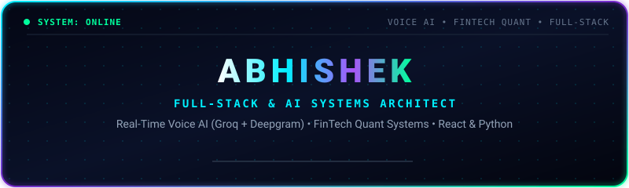

 

  
  
  
  
  

---

## 👨‍💻 Executive Engineering Profile

I am a **Full-Stack Developer and AI Systems Architect** focused on high-performance interactive web architectures, real-time conversational AI voice agents, cross-platform financial software, and quantitative algorithmic systems.

* 🎙️ **Conversational AI & Audio**: Built **[Nexus Voice AI](https://uniqabhishek.github.io/AI-Voice-Assistant/)**, an advanced voice agent engineered to **ChatGPT-4o & Gemini Live** standards with full-duplex speech barge-in interruption, dynamic liquid neural orb visualizer, continuous hands-free listening, direct YouTube autoplay & voice stream controls, and a multi-tier reasoning engine.
* ⚡ **FinTech & Behavioral Analytics**: Architected **[TradeMind AI](https://uniqabhishek.github.io/Trading-Journal/)**, an institutional-grade trading journal and psychological discipline workspace deployed across React 18, React Native (Expo), and Python Flask.
* 🍽️ **Full-Stack Product SaaS**: Engineered **[RestoFlow ONE](https://uniqabhishek.github.io/smart-restaurant-qr/)**, a contactless smart QR restaurant dine-in ecosystem featuring real-time kitchen display ticketing (KDS) and dynamic staff floor map tracking.
* 🤖 **Quantitative Algorithmic Systems**: Engineered **[QuantSignal](https://github.com/uniqabhishek/Trading-Bot)**, an asynchronous market scanner operating a 4-layer quantitative strategy with CCXT multi-exchange failover, Quart ASGI webhooks, and ATR dynamic risk sizing.
* 🎯 **Status**: **Open for High-Impact Software Engineering Roles** — actively interviewing for Full-Stack, AI Engineer, and Python Developer positions.

---

## 📊 Live Deployments & Executive Dashboard

| Project | Domain | Key Architecture | Live Web App | Repository |
| :--- | :--- | :--- | :--- | :--- |
| **Nexus Voice AI** | Conversational AI & Web Audio | Full-Duplex Barge-in, Web Speech API, Wikipedia REST, Groq LPU | [🚀 Launch Terminal](https://uniqabhishek.github.io/AI-Voice-Assistant/) | [📂 Source Code](https://github.com/uniqabhishek/AI-Voice-Assistant) |
| **TradeMind AI** | FinTech & Quantitative Journal | React 18, React Native (Expo), Tailwind, Encrypted Offline Storage | [🚀 Launch Terminal](https://uniqabhishek.github.io/Trading-Journal/) | [📂 Source Code](https://github.com/uniqabhishek/Trading-Journal) |
| **RestoFlow ONE** | Hospitality SaaS & Real-Time Ops | React 19, Smart QR Ordering, Kitchen KDS Station, Floor Map | [🚀 Launch Terminal](https://uniqabhishek.github.io/smart-restaurant-qr/) | [📂 Source Code](https://github.com/uniqabhishek/smart-restaurant-qr) |
| **QuantSignal AI** | Algorithmic Trading & Signal Bot | Python 3.10+, CCXT Multi-Exchange, Quart ASGI, 1:2 R:R ATR Risk | *Backend Daemon* | [📂 Source Code](https://github.com/uniqabhishek/Trading-Bot) |
| **Grain & Joint** | High-Performance E-Commerce | Semantic HTML5, CSS Grid / Flexbox, 100/100 Lighthouse Score | [🚀 Launch Terminal](https://uniqabhishek.github.io/furniture-website/) | [📂 Source Code](https://github.com/uniqabhishek/furniture-website) |

---

## 🌟 Detailed Project Spotlights

### 🎙️ 01 // Nexus Voice AI — Gemini Live & ChatGPT-4o Voice Agent

> **A real-time conversational voice agent matching ChatGPT-4o and Gemini Live voice mode standards, featuring sub-second spoken replies, continuous hands-free background listening, instant speech interruption, and dynamic YouTube video/audio streaming.**

- ⚡ **Key Engineering & Architecture Highlights**:
  - **Full-Duplex Speech Barge-In (Instant Interruption)**: The microphone stays active continuously using Web Speech API and hardware acoustic echo cancellation (AEC). Speaking at any moment while the assistant is talking immediately terminates speech synthesis (`window.speechSynthesis.cancel()`), transitioning the visualizer back to listening mode on the fly.
  - **Fluid Morphing Neural Orb Visualizer**: 64-point harmonic Canvas visualizer reacting in real time to audio frequencies, with dynamic state colorations (Cyan/Emerald for listening, Magenta/Purple for speaking, Coral Red for YouTube streaming).
  - **Multi-Tier Intelligence Engine**:
    1. *Real-Time Factual Knowledge*: Integrated Wikipedia REST API for instant, authoritative spoken answers to conceptual/scientific queries (*"What is quantum AI?"*, *"Explain black holes"*).
    2. *Fast Cloud LLM*: Natural generative completions for open-ended questions, creative thoughts, and philosophy.
    3. *Deep Local Conversational Brain*: Comprehensive matrix covering empathy, motivation, tech, humor, riddles, and life advice.
    4. *Groq LPU Acceleration*: Built-in settings drawer to optionally connect Groq API keys for Llama-3.3-70B inference at 500+ tokens/second.
  - **Direct YouTube Streaming & Voice Control**: Automatically embeds and autoplays any song or video on voice command (*"Play Believer"*, *"Play Hanuman Chalisa"*, *"Play Arijit Singh"*), with complete voice playback controls (*"Pause"*, *"Resume"*, *"Play"*) and proactive multi-turn follow-ups (*"Open YouTube"* $\rightarrow$ *"What song would you like to stream?"*).
  - **Human Female Voice Cadence**: Breaks sentences into natural clauses with 120ms breathing intervals to avoid robotic monotony.
- 🛠️ **Tech Stack**: `JavaScript (ES2024)`, `Web Audio API`, `HTML5 Canvas 2D`, `Web Speech API`, `YouTube IFrame API`, `Wikipedia REST API`, `Python`, `Flask 3.0`, `WebSockets`.

---

### ⚡ 02 // TradeMind AI — Institutional Trading Journal & Psychology Terminal

> **An institutional trading performance and behavioral psychology terminal engineered for Crypto, Forex, and Equity traders to eliminate cognitive biases and optimize risk distribution.**

- ⚡ **Key Engineering & Architecture Highlights**:
  - **Cross-Platform React & React Native**: Unified architecture sharing state logic across a modern responsive React 18 web application and an Expo React Native mobile client.
  - **Behavioral Psychology Matrix**: Maps emotional trade execution states (*Confidence, Discipline, FOMO, Revenge Trading, Anxiety*) against cumulative P&L equity curves to quantify psychological leakages.
  - **Quantitative Metric Computation**: Real-time evaluation of Win Rate, Profit Factor, Average R:R, Max Drawdown, and Risk-Weighted Expectancy.
  - **Zero-Server Client Privacy**: Fully encrypted client-side persistence with 1-click pre-populated institutional demo datasets for instant evaluation.
- 🛠️ **Tech Stack**: `React 18`, `React Native`, `Expo`, `Vite`, `Tailwind CSS`, `Lucide Icons`, `Python Flask`, `AsyncStorage`.

---

### 🍽️ 03 // RestoFlow ONE — Smart QR Dine-In & Kitchen KDS Ecosystem

> **A contactless smart QR restaurant dine-in and operations ecosystem linking guest digital menus directly to live Kitchen Display System (KDS) stations and staff floor management.**

- ⚡ **Key Engineering & Architecture Highlights**:
  - **Contactless Guest Ordering**: Dynamic QR menu with dish customizations, dietary tags, dietary allergy alerts, and real-time order cart management.
  - **Live Kitchen Display System (KDS)**: Real-time ticket dispatch board for chefs with elapsed time tracking, order priority queues, and preparation state toggles (*Incoming $\rightarrow$ Cooking $\rightarrow$ Ready for Pickup*).
  - **Interactive Staff Floor Map**: Visual restaurant floor grid showing table occupancy states, active dine-in orders, and instant waiter assistance requests.
  - **High-Velocity State Management**: Zero-latency coordination between guest ordering view, kitchen operations, and billing stations.
- 🛠️ **Tech Stack**: `React 19`, `JavaScript (ES2024)`, `Tailwind CSS`, `HTML5 QR Routing`, `Vite`.

---

### 🤖 04 // QuantSignal AI — Quantitative Algorithmic Trading Engine

> **An asynchronous quantitative market scanner and automated Telegram signal bot built in Python 3.10+ executing strict statistical risk parameters.**

- ⚡ **Key Engineering & Architecture Highlights**:
  - **4-Layer Quantitative Strategy**: Eliminates false breakouts by requiring strict confluence across Higher Timeframe 200 EMA trend, RSI momentum filter, MACD crossover confirmation, and a **1.5× volume surge** against the 20-period moving average.
  - **Dynamic Volatility Risk Control**: Calculates precision Stop-Loss ($1.5 \times \text{ATR}$) and Take-Profit ($3.0 \times \text{ATR}$) levels, locking in an asymmetric 1:2.0 Risk-to-Reward ratio.
  - **Multi-Exchange Failover Engine**: Resilient crypto market data feeds via CCXT with automatic primary-to-secondary failover (MEXC $\rightarrow$ Gate.io) and exponential backoff retry policies.
  - **Asynchronous ASGI Architecture**: Powered by Quart and Hypercorn for high-throughput webhook handling, `/health` monitoring, and Telegram event dispatching.
- 🛠️ **Tech Stack**: `Python 3.10+`, `CCXT`, `Quart ASGI`, `Pandas`, `NumPy`, `Telegram Bot API`, `yfinance`, `Hypercorn`.

---

### 🪑 05 // Grain & Joint — Bespoke Solid Wood Furniture Atelier

> **An editorial-grade e-commerce showcase for an artisanal solid wood furniture atelier, built with zero framework bloat to achieve perfect 100/100 Lighthouse performance.**

- ⚡ **Key Engineering & Architecture Highlights**:
  - **Perfect 100/100 Performance Score**: Ultra-lean, sub-50ms First Contentful Paint (FCP) achieved through pure semantic HTML5 and vanilla CSS.
  - **Modern CSS Grid & Fluid Design**: Complex editorial layouts, responsive aspect ratio management, and custom CSS design tokens.
  - **Zero Dependency Footprint**: No external runtime libraries, ensuring zero bundle overhead and universal mobile compatibility.
- 🛠️ **Tech Stack**: `HTML5 Semantic Markup`, `Modern CSS3 Variables`, `CSS Grid & Flexbox`, `Vanilla JavaScript`.

---

### 🐍 06 // Core Python Engineering & Computational Systems

> **Foundational computer science implementations, algorithm drills, and modular Python automation libraries.**

- **[Python-Project](https://github.com/uniqabhishek/Python-Project)**: Intent-based natural language virtual assistant and desktop automation engine with local knowledge-base matching.
- **[practice-question](https://github.com/uniqabhishek/practice-question)**: Algorithmic problem-solving drills covering complex data structures, search algorithms, recursion, and string manipulation.
- **[projects](https://github.com/uniqabhishek/projects)**: Modular utility functions and scripting labs for production data handling.
- **[loop](https://github.com/uniqabhishek/loop) & [if-else](https://github.com/uniqabhishek/if-else)**: Iteration control algorithms, series generation, and conditional logic architectures.

---

## 🛠️ Technical Arsenal

### AI, Speech & Audio Systems

### Full-Stack & Frontend

### Backend, FinTech & Data

---

## 📈 Activity & Contribution Telemetry

---

## 📬 Direct Contact & Network

I am actively interviewing for **Full-Stack Engineer, AI Software Engineer, and Python Developer** roles.

  

<samp>
  <b>[SYSTEM ARCHITECTURE]</b>: <i>"Engineered for sub-second execution, resilient fault-tolerance, and clean human experiences."</i>
</samp>

