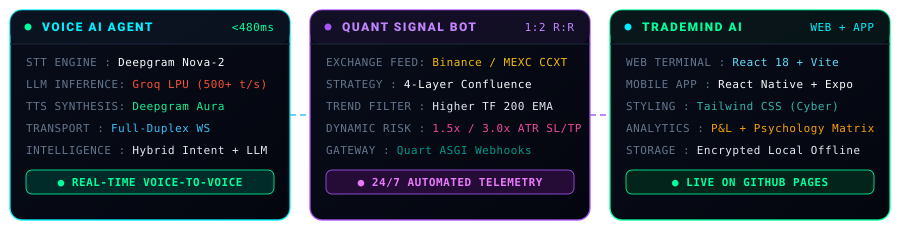
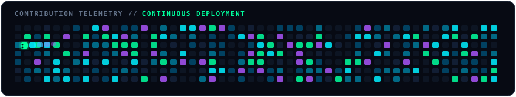

 

  
  
  
  

## 🛰️ System Architecture & Telemetry

  

## ⚡ Flagship Engineering Deployments

<table>
  <tr>
    <td width="50%" valign="top">
      <h3 align="center">🎙️ Real-Time Voice AI Agent — Deepgram & Groq LPU</h3>
      

        
        
        
      

      
<b>An ultra-low-latency conversational Voice AI Agent capable of natural human dialogue with sub-second voice-to-voice turnarounds.</b>

      <ul>
        <li><b>Voice-to-Voice Pipeline</b>: Browser microphone audio streams raw PCM via WebSockets directly to Deepgram Nova-2 (STT), transcribing speech in real time.</li>
        <li><b>Groq LPU Acceleration</b>: Streams token reasoning at <b>500+ tokens/sec</b> using LLaMA/GPT-OSS models via Groq's Tensor Engine.</li>
        <li><b>Natural Speech Synthesis</b>: Deepgram Aura synthesizes fluid conversational audio frames piped back over WebSockets without disk buffering.</li>
        <li><b>Hybrid Intelligence</b>: Token-aware weighted intent scoring against JSON knowledge bases with instant Groq LLM fallback for open-ended queries.</li>
        <li><b>Tech Stack</b>: <code>Python</code>, <code>Deepgram SDK</code>, <code>Groq API</code>, <code>WebSockets (flask-sock)</code>, <code>Flask 3.0</code>.</li>
      </ul>
    </td>
    <td width="50%" valign="top">
      <h3 align="center">📈 TradeMind AI — Trading Journal & Psychology Terminal</h3>
      

        
        
        
      

      
<b>An institutional-grade trading performance and behavioral psychology terminal built for Crypto, Forex, and Equity traders.</b>

      <ul>
        <li><b>Cross-Platform Architecture</b>: Responsive React web app alongside a native mobile app built with <b>React Native & Expo</b>.</li>
        <li><b>Psychology Correlation Matrix</b>: Tracks emotional discipline states (Confidence, FOMO, Revenge, Anxiety) and models their statistical impact on net P&L.</li>
        <li><b>Zero-Server Privacy</b>: 100% offline encrypted local storage powered by Async Storage with instant 1-click demo dataset preview.</li>
        <li><b>Real-Time Analytics</b>: Live Net Realized P&L, profit factor, win-rate curves, and risk distribution metrics.</li>
        <li><b>Tech Stack</b>: <code>React 18</code>, <code>React Native</code>, <code>Expo</code>, <code>Vite</code>, <code>Tailwind CSS</code>, <code>Python Flask</code>.</li>
      </ul>
    </td>
  </tr>
  <tr>
    <td width="50%" valign="top">
      <h3 align="center">🤖 QuantSignal AI — Quantitative Algorithmic Trading Engine</h3>
      

        
        
        
      

      
<b>An asynchronous quantitative market scanner and automated Telegram signal engine built in Python 3.10+.</b>

      <ul>
        <li><b>4-Layer Quantitative Strategy</b>: Eliminates false signals by demanding confluence across Macro 200 EMA trend, RSI momentum, MACD crossover, and a <b>1.5× volume surge</b>.</li>
        <li><b>Dynamic Volatility Risk</b>: Automatically sets Stop-Loss (1.5× ATR) and Take-Profit (3.0× ATR) targeting an asymmetric 1:2 R:R ratio.</li>
        <li><b>Multi-Exchange Failover</b>: Continuous market uptime via CCXT with automated failover (MEXC ➔ Gate.io) and exponential backoff retry loops.</li>
        <li><b>Async ASGI Architecture</b>: Powered by Quart and Hypercorn with <code>/health</code> endpoints and Telegram Webhook event processing.</li>
        <li><b>Tech Stack</b>: <code>Python</code>, <code>CCXT</code>, <code>Quart</code>, <code>Pandas</code>, <code>NumPy</code>, <code>Telegram Bot API</code>, <code>yfinance</code>.</li>
      </ul>
    </td>
    <td width="50%" valign="top">
      <h3 align="center">🪑 Grain & Joint — Artisanal E-Commerce Atelier</h3>
      

        
        
        
      

      
<b>A bespoke, editorial-grade e-commerce catalog for an artisanal solid wood studio built with zero bloated frameworks.</b>

      <ul>
        <li><b>100/100 Lighthouse Performance</b>: Instant rendering speed achieved via pure semantic HTML5 and vanilla CSS architecture.</li>
        <li><b>Advanced CSS Systems</b>: Fluid CSS Grid & Flexbox, CSS Custom Properties, and editorial typography (Fraunces & Work Sans).</li>
        <li><b>Responsive Ergonomics</b>: Fluid viewport transitions from mobile screens to ultra-wide desktop monitors.</li>
        <li><b>Interactive Micro-Interactions</b>: Tactile catalog cards, hover transitions, and accessible DOM structures.</li>
        <li><b>Tech Stack</b>: <code>HTML5</code>, <code>Modern CSS3 Variables</code>, <code>CSS Grid</code>, <code>Vanilla JavaScript</code>.</li>
      </ul>
    </td>
  </tr>
</table>

## 🛠️ Technical Arsenal & Core Matrix

### 🤖 AI, Machine Learning & Voice Systems

  
  
  
  
  
  

### 💻 Languages & Core Runtime

  
  
  
  
  
  

### 🌐 Frontend & Mobile Ecosystem

  
  
  
  
  

### ⚙️ Backend, Asynchronous Engines & FinTech

  
  
  
  
  
  

### 🚀 Cloud Infrastructure & DevOps

  
  
  
  
  

## 📈 Activity Telemetry & Continuous Motion

 

## 📡 Encrypted Transmissions // Let's Connect

I am actively interviewing for **Full-Stack Engineer, AI Software Engineer, and Python Developer** roles.

  

<samp>
  <b>[SYSTEM NOTICE]</b>: <i>"Architecting resilient systems with zero-latency execution, disciplined logic, and clean code."</i>
</samp>

