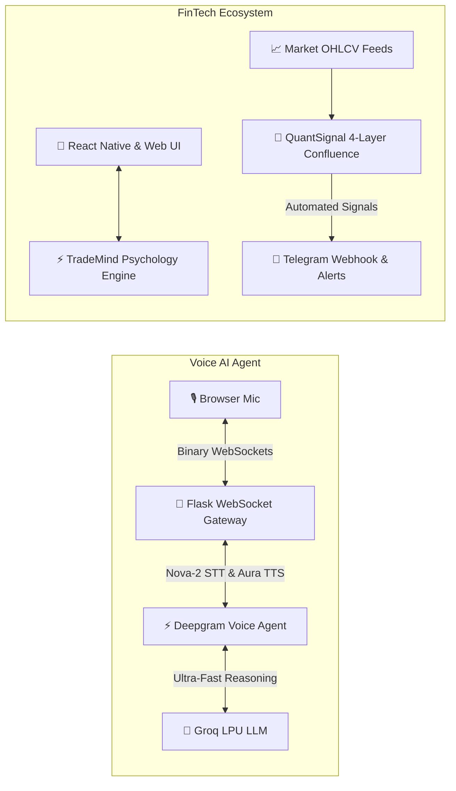

# Hi, I'm Abhishek 👋

  
  
  
  

---

## 👨‍💻 About Me

I am a **Full-Stack Developer and AI Systems Engineer** passionate about building cutting-edge conversational voice AI agents, full-stack trading software, and algorithmic financial systems.

- 🎙️ **Voice AI & LLM Systems**: Architected a **sub-second Real-Time Conversational Voice AI Agent** leveraging **Deepgram's Voice Agent API** (Nova-2 STT & Aura TTS), **Groq's LPU Inference Engine** (500+ tokens/sec), and full-duplex WebSockets.
- 🚀 **Production Web & Mobile Products**: Created **[TradeMind AI](https://uniqabhishek.github.io/Trading-Journal/)**, an institutional trading performance and psychology workspace across React, React Native (Expo), and Python Flask.
- 🤖 **Quantitative Algorithmic Systems**: Built **[QuantSignal](https://github.com/uniqabhishek/Trading-Bot)**, an automated quantitative market scanner combining CCXT exchange routing, multi-timeframe 200 EMA trend filters, and dynamic ATR risk control.
- 💼 **Current Status**: **Open for Opportunities** — actively interviewing for Full-Stack, AI Engineer, Frontend, and Python Software Engineering roles.

---

## 🏛️ System Architecture Showcase

---

## 🌟 Featured Engineering Projects

<table>
  <tr>
    <td width="50%" valign="top">
      <h3 align="center">🎙️ Real-Time Conversational Voice AI Agent</h3>
      

        
        
        
      

      
A production-ready, conversational voice agent capable of human-like spoken dialogue without robotic pauses.

      <ul>
        <li><b>Deepgram Voice Agent API</b>: Bidirectional streaming STT (Nova-2) and natural speech synthesis (Aura).</li>
        <li><b>Groq LPU Inference</b>: Lightning-fast LLM reasoning generating token streams at 500+ tokens/sec.</li>
        <li><b>WebSocket Audio Gateway</b>: Low-latency binary audio relay built on <code>flask-sock</code> without disk buffering.</li>
        <li><b>Hybrid Intelligence</b>: Fast token-aware local intent classification with seamless Groq LLM fallback.</li>
      </ul>
    </td>
    <td width="50%" valign="top">
      <h3 align="center">⚡ TradeMind AI — Trading Journal & Psychology Workspace</h3>
      

        
        
      

      
Modern trading performance and psychology workspace built for Crypto, Forex, and Stock traders.

      <ul>
        <li><b>Cross-Platform</b>: Responsive React web app + Native Expo mobile application (Android/iOS) + Flask backend.</li>
        <li><b>Psychology Matrix</b>: Correlates emotional discipline (Confidence, FOMO, Revenge) with net P&L.</li>
        <li><b>Offline Encrypted Storage</b>: Operates seamlessly without server dependency using Async Storage.</li>
        <li><b>Stack</b>: React, React Native, Vite, Tailwind CSS, Python Flask, Render, Vercel.</li>
      </ul>
    </td>
  </tr>
  <tr>
    <td width="50%" valign="top">
      <h3 align="center">🤖 QuantSignal AI — Quantitative Trading Engine & Bot</h3>
      

        
        
      

      
An asynchronous quantitative market scanner and algorithmic Telegram signal bot built with Python 3.10+.

      <ul>
        <li><b>4-Layer Quantitative Strategy</b>: 200 EMA Higher TF trend filter + RSI momentum + MACD cross + 1.5× volume surge.</li>
        <li><b>Dynamic ATR Risk Control</b>: Automated Stop-Loss (1.5× ATR) and Take-Profit (3.0× ATR) targeting a 1:2 R:R ratio.</li>
        <li><b>Multi-Exchange Failover</b>: CCXT integration with automatic failover (MEXC ➔ Gate.io).</li>
        <li><b>Stack</b>: Python, CCXT, Telegram API, Quart ASGI, Pandas, NumPy, Hypercorn.</li>
      </ul>
    </td>
    <td width="50%" valign="top">
      <h3 align="center">🪑 Grain & Joint — Bespoke E-Commerce Web Experience</h3>
      

        
        
      

      
An editorial-grade e-commerce catalog for an artisanal solid wood furniture atelier.

      <ul>
        <li><b>100/100 Lighthouse Performance</b>: Zero heavy framework dependencies; pure semantic HTML5 & modern CSS.</li>
        <li><b>Design Systems</b>: Custom CSS Grid & Flexbox, CSS variables color harmony, typography pairing (Fraunces & Work Sans).</li>
        <li><b>Mobile-First UX</b>: Fluid responsiveness across mobile, tablet, and desktop viewports.</li>
      </ul>
    </td>
  </tr>
</table>

---

## 🛠️ Technical Arsenal

### AI & Machine Learning

### Languages & Core

### Frontend & Mobile

### Backend & APIs

-009688?style=for-the-badge&logo=fastapi&logoColor=white)

### FinTech & Data Engineering

### Tools & DevOps

---

## 📈 Activity & Contribution Streak

---

## 📬 Let's Connect & Collaborate!

I am actively interviewing for **Full-Stack Engineer, AI Software Engineer, and Python Developer** roles.

  
  
  
  

  <i>"Speed, precision, and clean code — building intelligent systems that scale."</i>

